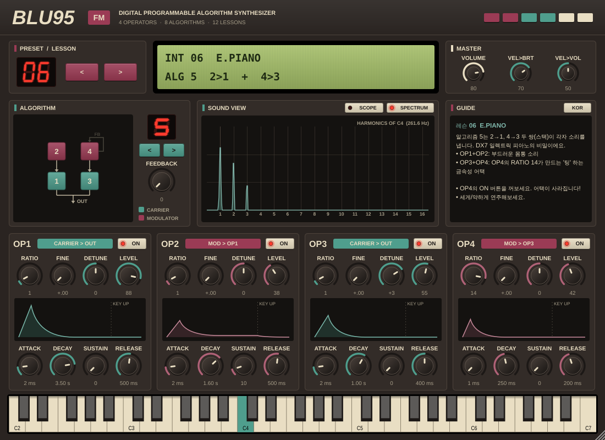

# BLU95 FM

**FM 합성을 직접 만지면서 배우는 4-오퍼레이터 FM 신시사이저** (VST3 / AU / Standalone)

DX7의 레트로한 패널 디자인에서 영감을 받았습니다: 짙은 초콜릿색 바디, 적갈색·청록색·크림색 멤브레인 버튼, 초록빛 백라이트 LCD, 빨간 7-세그먼트 LED.



---

## 무엇이 다른가요?

일반 FM 신스는 파라미터가 수십 개라 처음엔 막막합니다. BLU95는 **"배우기"** 에 초점을 맞췄어요.

| 기능 | 무엇을 배울 수 있나 |
|---|---|
| **알고리즘 다이어그램** | 어떤 오퍼레이터가 소리를 내고(캐리어, 청록색) 어떤 오퍼레이터가 음색을 만드는지(모듈레이터, 적갈색) 한눈에 보입니다. |
| **스펙트럼 뷰** | 누른 음의 1, 2, 3… 배수 눈금 위에 배음이 그려집니다. 정수 비율 → 막대가 눈금 위에, 비정수 비율 → 눈금 사이에 (종소리). |
| **스코프 뷰** | 모듈레이션 깊이/피드백에 따라 파형이 어떻게 바뀌는지 봅니다. |
| **LCD 실시간 해설** | 손잡이에 마우스를 올리면 `MOD INDEX = 1.57 RAD`, `C:M = 1.00 : 3.50` 처럼 지금 값의 의미를 보여줍니다. |
| **가이드 패널** | 모든 손잡이의 설명(한국어/영어 전환 가능). |
| **12개의 레슨 프리셋** | 사인파 하나에서 시작해 E.Piano, 종, 브라스, 베이스까지 한 단계씩. |
| **오퍼레이터 ON/OFF** | DX7처럼 오퍼레이터를 끄고 켜서 각각의 역할을 귀로 확인합니다. |
| **화면 건반** | MIDI 건반이 없어도 마우스나 컴퓨터 키보드(A W S E D F …)로 연주할 수 있습니다. |

---

## FM 합성 3분 요약

1. **오퍼레이터** = 사인파 발진기 + 엔벨로프. BLU95에는 4개가 있습니다.
2. **캐리어(Carrier)** 는 소리가 나는 오퍼레이터, **모듈레이터(Modulator)** 는 다른 오퍼레이터의 주파수(위상)를 흔드는 오퍼레이터입니다.
3. **RATIO** — 오퍼레이터 주파수 = 건반 주파수 × RATIO.
   캐리어:모듈레이터 비율(**C:M**)이 *어디에* 배음이 생길지를 정합니다.
   - 1:1 → 모든 배음 (톱니파 같은 소리)
   - 1:2 → 홀수 배음 (사각파, 클라리넷 같은 소리)
   - 1:3.5 → 비화성 배음 (종, 금속 소리)
4. **LEVEL** — 캐리어에선 음량, 모듈레이터에선 **모듈레이션 인덱스**(변조 깊이)입니다. 클수록 배음이 *많아지고* 밝아집니다.
5. **엔벨로프** — 모듈레이터의 엔벨로프는 "음량"이 아니라 **"밝기의 시간 변화"** 를 만듭니다. 브라스의 "빠-앙", 피아노의 "팅"이 여기서 나옵니다.
6. **피드백** — OP4가 자기 자신을 변조합니다. 사인파 하나가 톱니파처럼 변합니다.
7. **알고리즘** — 4개 오퍼레이터의 연결 방법 8가지.

| # | 연결 | 캐리어 | 특징 |
|---|---|---|---|
| 1 | 4→3→2→1 | 1 | 직렬 스택. 가장 복잡하고 거친 음색 |
| 2 | (3+4)→2→1 | 1 | |
| 3 | (3→2)+4 → 1 | 1 | |
| 4 | (4→3)+2 → 1 | 1 | |
| 5 | 2→1, 4→3 | 1, 3 | 두 개의 독립된 쌍. E.Piano |
| 6 | 4 → 1+2+3 | 1, 2, 3 | 하나의 모듈레이터가 셋을 변조 |
| 7 | 4→3, 1, 2 | 1, 2, 3 | |
| 8 | 1+2+3+4 | 전부 | 가산 합성 (오르간) |

## 레슨 프리셋

| # | 이름 | 배우는 것 |
|---|---|---|
| 01 | SINE WAVE | 캐리어 하나 = 순수한 사인파 |
| 02 | FIRST FM | 모듈레이터 하나, C:M = 1:1, 모듈레이션 인덱스 |
| 03 | HOLLOW 1:2 | 비율이 배음의 위치를 바꾼다 |
| 04 | BELL | 비정수 비율 = 비화성 배음 |
| 05 | BRASS | 모듈레이터 엔벨로프 = 밝기의 변화 |
| 06 | E.PIANO | 알고리즘 5, 두 개의 스택 |
| 07 | FM BASS | 짧은 모듈레이터 DECAY = 펀치 |
| 08 | ORGAN | 알고리즘 8, 가산 합성 |
| 09 | MARIMBA | SUSTAIN 0 = 타악기 |
| 10 | FEEDBACK | 피드백으로 사인 → 톱니 |
| 11 | STRINGS PAD | 디튠과 느린 엔벨로프 |
| 12 | SPACE BELLS | 알고리즘 6, 무리수 비율 |

---

## 설치

### 빌드된 파일 받기

GitHub 저장소의 **Actions** 탭 → 최신 **Build** 실행 → 아래쪽 **Artifacts** 에서 운영체제에 맞는 파일을 받습니다.

| OS | 복사할 위치 |
|---|---|
| Windows | `Blu95 FM.vst3` → `C:\Program Files\Common Files\VST3\` |
| macOS | `Blu95 FM.vst3` → `~/Library/Audio/Plug-Ins/VST3/`<br>`Blu95 FM.component` → `~/Library/Audio/Plug-Ins/Components/` |
| Linux | `Blu95 FM.vst3` → `~/.vst3/` |

DAW에서 플러그인을 다시 스캔하세요. `Standalone` 폴더에는 DAW 없이 바로 실행되는 앱이 있습니다.

> macOS: 서명되지 않은 빌드라 처음에 차단될 수 있습니다. 터미널에서
> `xattr -cr ~/Library/Audio/Plug-Ins/VST3/"Blu95 FM.vst3"` 를 실행하세요 (AU도 같은 방법).

### 직접 빌드하기

CMake 3.22 이상과 C++17 컴파일러(Visual Studio 2022, Xcode, GCC/Clang)가 필요합니다. JUCE는 자동으로 다운로드됩니다.

```bash
cmake -B build -DCMAKE_BUILD_TYPE=Release
cmake --build build --config Release
```

결과물: `build/Blu95Synth_artefacts/Release/` (VST3, AU, Standalone)

Linux에서는 먼저 의존성을 설치하세요:

```bash
sudo apt install libasound2-dev libfreetype-dev libx11-dev libxext-dev \
  libxinerama-dev libxrandr-dev libxcursor-dev libgl1-mesa-dev
```

---

## 사운드 엔진

- 4 오퍼레이터, 8 알고리즘, OP4 셀프 피드백, 16 보이스 폴리포니
- 위상 변조(Phase Modulation) 방식: DX7과 같은 방식으로, 모듈레이터 출력이 캐리어의 위상에 더해집니다
- 오퍼레이터별: RATIO (0.5, 1–16) + FINE (+0.00–0.99), DETUNE (±7, 1단계 ≈ 2센트), LEVEL, ADSR
- LEVEL 0–100 → 진폭 (LEVEL/100)², 모듈레이터일 때 최대 모듈레이션 인덱스 2π rad
- 벨로시티 → 밝기 (모듈레이터 레벨), 벨로시티 → 음량 (캐리어 레벨)
- 키 싱크 (노트마다 위상 0에서 시작), 피치 벤드 ±2 반음, 서스테인 페달
- 피드백이 만드는 DC 오프셋 제거 필터

## 코드 구조

```
Source/
  Parameters.*        파라미터 정의 (APVTS)
  Algorithms.h        8개 알고리즘의 연결 정보
  FMVoice.*           FM 보이스, 엔벨로프, 사인 테이블
  Presets.*           12개 레슨 프리셋 (한/영 설명 포함)
  InfoText.*          손잡이별 도움말
  PluginProcessor.*   오디오 처리, 상태 저장, 프로그램
  PluginEditor.*      프런트 패널 레이아웃, LCD/가이드 갱신
  Components.*        노브, LCD, LED, 알고리즘 다이어그램, 스코프/스펙트럼, 오퍼레이터 패널
  RetroLookAndFeel.*  DX7 풍 색상과 멤브레인 버튼
```

---

*BLU95는 DX7의 디자인에 대한 오마주이며 Yamaha와 관련이 없습니다.*
